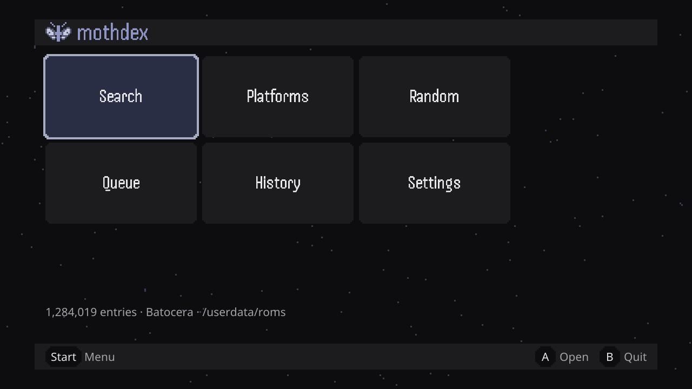
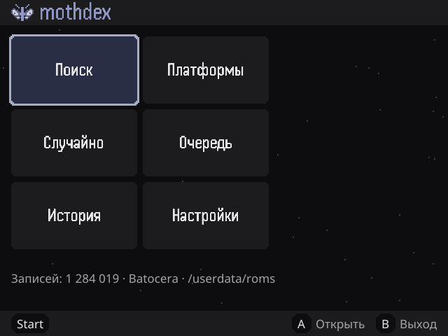
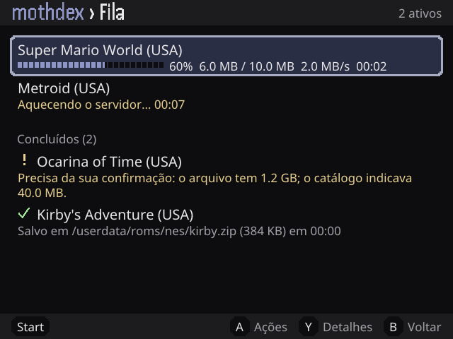
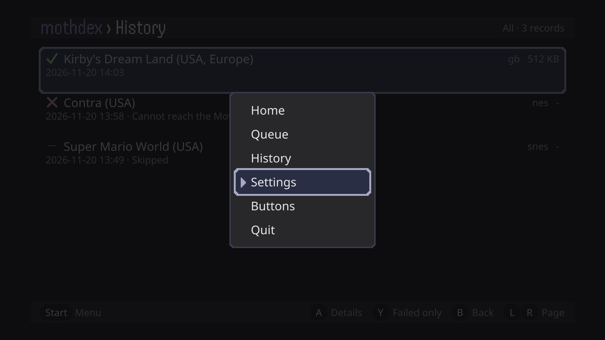

# Design

Owner: Bússola (UX/UI). Status: **approved by the owner (D30)** (T-81, Decisions D28 8b, D29 and D30). Not
implemented yet; Vitral implements it.

This file holds the visual identity. Behavior, layout per screen, focus model and copy stay in
[`docs/ux/gui.md`](docs/ux/gui.md) (GUI), [`docs/ux/tui.md`](docs/ux/tui.md), [`docs/ux/shell.md`](docs/ux/shell.md)
and [`docs/ux/cli-conventions.md`](docs/ux/cli-conventions.md). When a value here and a value in gui.md §1 differ, this
file wins for color, type face and shape, and gui.md §1.3 and §1.4 stay the authority for sizes.

## GUI: "Night moth arcade"

The GUI should feel like the Mothdex website after dark, played on a console. That is the owner's direction (D29): it
looks like mothdex.net and has a retro-game appearance.

- **From mothdex.net:**
  - A near-black night background with graphite surfaces.
  - A muted periwinkle that the site uses for its wordmark and buttons.
  - The moth as the only emblem.
  - Calm, uncluttered screens.
- **Retro-game layer (generic, owned by no game):**
  - A pixel grid that every shape snaps to.
  - Stepped corners instead of round ones.
  - A pixel display face for short labels.
  - A menu cursor, segmented progress bars and framed windows, as in classic console menus.
  - A sky of still pixel specks on Home.
- **Use scene:** a TV across the room or a 3.5-inch handheld, in a dim room, held with a pad. Dark is chosen for that
  scene, not by habit: it keeps a TV from glowing and matches the site.

Mocks (the real screens drawn with these tokens, from the PR 99 code; throwaway renderer, not shipped):

| Home, 1280x720 | Home, 640x480 (ru_ru) |
|---|---|
|  |  |

| Queue, 640x480 (pt_br) | Start menu over History, 1920x1080 |
|---|---|
|  |  |

Not copied from anywhere:
- No logo, photo, artwork or file from mothdex.net. The site's moth is line art; ours is a new pixel sprite.
- No sprite, font or layout from an existing game.
- Both fonts are OFL.

### Pixel grid

Every shape is built from square **pixel cells** of size `P`. No anti-aliased curves are drawn, except the glyphs of
the body font.

| Token | compact | standard | large |
|---|---|---|---|
| `P` (pixel cell) | 2 | 3 | 4 |

- Ring widths, progress heights, gaps and sprite cells round to a multiple of `P`: ring = `P` x round(ring / `P`).
- The 480x320 scaled layout renders compact at 640x480 and lets SDL scale it, so `P` stays 2.
- The `space.unit` (`u`) and every size of gui.md §1.4 are unchanged.

### Color tokens

The values come from the mothdex.net palette (`--color-bg`, `--color-bg-2`, `--color-bg-4`, `--color-text`,
`--color-primary`, `--color-secondary` and its success and danger text colors). Two values were added for
legibility: `text.dim` and `warn`.

| Token | Hex | Use | Replaces (gui.md §1.5) |
|---|---|---|---|
| `color.bg` | `#0D0D10` | full-screen background, the night sky | `#0F1317` |
| `color.surface` | `#1C1C1E` | top and hint bars, rows, tiles, keys | `#1A2027` |
| `color.surface.raised` | `#28282A` | windows over the scrim: dialogs, Start menu, sheets, details, keyboard | new |
| `color.frame` | `#3A3D52` | the `P` frame around raised windows; sky specks | new |
| `color.focus.bg` | `#2A2E44` | fill of the focused element | `#123447` |
| `color.focus.ring` | `#A8ACC2` | focus frame and menu cursor (site `--color-primary`) | `#5CC8FF` |
| `color.text` | `#E7E6E8` | primary text (site `--color-text`) | `#F1F4F6` |
| `color.text.dim` | `#A3A3A8` | secondary text, hints | `#A3AFBA` |
| `color.moth` | `#8F95C4` | the wordmark, progress fill, badges, selected marks (`accent`) | `#5CC8FF` |
| `color.moth.deep` | `#595D7A` | sprite wing shading only, never text (site `--color-secondary`) | new |
| `color.moth.light` | `#C9CCE0` | sprite highlights only | new |
| `color.ok` | `#A1E698` | Done (site success text) | `#5DD68C` |
| `color.warn` | `#E6CF8F` | Warming, RetryWait, needs your OK, stale, offline | `#F4B740` |
| `color.error` | `#E698A3` | Failed (site danger text) | `#FF7A7A` |
| `color.scrim` | `#0D0D10` at 80 % | behind windows | `#0F1317` at 80 % |

Measured contrast (WCAG 2.x formula):

| Foreground | on `bg` | on `surface` | on `surface.raised` | on `focus.bg` |
|---|---|---|---|---|
| `text` | 15.6 | 13.7 | 11.8 | 10.7 |
| `text.dim` | 7.7 | 6.8 | 5.9 | 5.3 |
| `moth` | 6.7 | 5.9 | 5.1 | 4.6 |
| `focus.ring` | 8.6 | 7.6 | 6.6 | 5.9 |
| `ok` | 13.2 | 11.6 | 10.0 | 9.1 |
| `warn` | 12.7 | 11.1 | 9.6 | 8.7 |
| `error` | 8.7 | 7.6 | 6.6 | 6.0 |

- **Text:** every pair passes AA (4.5:1), and `text` passes AAA everywhere.
- **Focus ring:** passes the 3:1 non-text rule against every background.
- **Decorative only, never carrying meaning:** `frame` (1.4:1 on `surface.raised`), the sky specks and `moth.deep`.
- **Unchanged from gui.md §1.5:**
  - The fill rules for discs and pills.
  - Color never carries meaning alone.
  - Disabled elements give a reason, not just a grey tone.

### Type

| Role | Face | compact | standard | large | Use |
|---|---|---|---|---|---|
| `display` | Handjet | 35 | 46 | 68 | top bar title and wordmark, Home tile labels, Settings section headers, the calibration percent, splash |
| `title` | Noto Sans | 26 | 34 | 50 | entry title on the Entry screen, dialog titles (sentences) |
| `body` | Noto Sans | 20 | 26 | 38 | as gui.md §1.3 |
| `secondary` | Noto Sans | 17 | 21 | 31 | as gui.md §1.3 |
| `minimum` | Noto Sans | 16 | 18 | 27 | as gui.md §1.3 |

- **Handjet** (OFL, google/fonts `ofl/handjet`) is a condensed pixel face with full Latin and Cyrillic: pt_br,
  es_es, en and ru_ru were checked, including `ç ã õ ñ ¿ ё й ъ`. Its narrow letters echo the condensed weight of the
  site's Doppio One. Doppio One has no Cyrillic, so it cannot be used.
  - Embed the default instance only, subset to Latin, Latin-1, Latin Extended-A and Cyrillic, as is done for Noto
    Sans.
  - Add `THIRD_PARTY/Handjet-OFL-1.1.txt` and a row in `THIRD_PARTY/README.md`.
  - Handjet renders smaller than Noto at the same pixel size, so `display` = `title` x 1.35.
- **Display is for short labels only:** names of screens, tiles and sections, numbers. Any sentence, list row, title
  of a game or dialog text stays in Noto Sans. That keeps body text legible from a couch and keeps long game titles
  readable.
- Rejected:
  - Press Start 2P: legible, but too wide for 640x480 (`mothdex › Configurações` does not fit), and the most common
    retro cliché.
  - Pixelify Sans: lacks Cyrillic `О` and `П`.
  - Silkscreen: no Cyrillic.
- **Fallback:** when Handjet has no glyph, the label is drawn in Noto Sans at the `title` size.
- `gui.text_size` = `large` scales `display` by 1.25 like the other roles.

### Shape

| Element | Corners | Notes |
|---|---|---|
| tiles, rows, keys, bars, windows, buttons | 2-step notch: remove `P` x `2P` and `2P` x `P` at each corner | replaces the corner radius of gui.md §1.4 |
| button discs, pills, the hint-bar `Start` pill | 3-step notch (`P`, `2P`, `3P`) | reads as a pixel circle or capsule |
| focus frame | 2-step notch, outside the element | ring width as gui.md §1.4, rounded to a multiple of `P` |

- A notched rectangle is 3 filled rectangles in SDL, cheap in the software renderer.
- No shadows, gradients, glows or blur.

### Components

- **Focus:** the `focus.bg` fill plus the stepped `focus.ring` frame, as now.
  - **Menu cursor:** in vertical menus (Start menu, action sheets, choice lists, the language editor), the focused item
    also shows a right-pointing pixel arrow in `focus.ring`. Its height is 0.8 x `body`, rounded to `P`; it sits
    `1u` inside the left edge, and the item text starts at `3u`.
  - Grids, lists and dialog buttons use the frame alone.
  - The cursor does not blink.
- **Windows** (dialogs, Start menu, sheets, details, Buttons overlay, keyboard): `surface.raised` with a `P` frame in
  `color.frame` outside it, over the `scrim`. This reads as a classic console text window and separates layers
  without shadows.
- **Top bar:**
  - The wordmark `mothdex` is in `display` and `color.moth`; the crumbs (`› Queue`) are in `display` and `text`.
  - On Home and the splash, the moth sprite sits `1u` before the wordmark, with its height equal to the cap height
    of the wordmark: 12 cells at `P`.
- **Home tiles:** labels in `display`. Tiles keep the §1.4 size and the 2-step notch.
- **Hint bar:** discs and pills with the 3-step notch, labels in `secondary` (Noto). The D-pad triangles of PR 99 are
  drawn on the pixel grid.
- **Progress bar:** segmented. Blocks are `3P` wide with a `P` gap, the height follows gui.md §1.4, and blocks are
  filled in `moth` over a `bg` track drawn in the same blocks. The percent stays in text beside it.
- **Spinner:** 8 blocks of `2P` around a `6P` square. One step per 100 ms, the newest block at full color and the rest
  fading to 25 %. Replaces the ring of gui.md §4.
- **Status marks** (`✔ ✘ ! – ↓`): drawn on the pixel grid in the state colors, at the cap height of the text beside
  them (gui.md §1.3 rule, now pixel-aligned).
- **Night sky (Home and splash only):** still specks of `P` x `P` in `color.frame`, about one per 5,200 px² of
  screen, at fixed positions from a seeded list. They are drawn on `bg` only, never over a surface, and never move.
- **Settings section headers:** `display` in `text.dim`.
- **Calibration view:** the percent is in `display`. The corner brackets are pixel Ls in `focus.ring`, as gui.md §1.2
  says.

### Motion

- **No tweening:** focus, scroll and windows change in a single frame, as on old consoles. This is also the calmest
  choice for a TV and costs nothing in the software renderer.
- **The one authored moment** is the splash moth: two wing frames, 250 ms each, while the app starts. It stops as soon
  as Home is ready.
- The spinner steps every 100 ms, as above. Nothing else moves.

### Assets

- **Fonts:** Noto Sans, kept as body and fallback, and Handjet for display. Both are OFL and listed in `THIRD_PARTY`.
- **Moth sprite:** 16 x 12 cells, symmetric, in `moth`, `moth.deep` and `moth.light`. The reference grid below is the
  one used in the mocks; Aquarela draws the final sprite and the wing frames from it. Legend: `#` = `moth`, `+` =
  `moth.deep`, `o` = `moth.light`, `.` = transparent. The left half is shown; the right half mirrors it.

  ```
  ...#....
  ....#...
  .....#.#
  .++....#
  +oo++..#
  +ooo++.#
  +o+oo+##
  .+ooo+##
  ..++++.#
  ...+oo+#
  ....++.#
  .......#
  ```

- The sprite is drawn as cell rectangles or as a small embedded PNG scaled by nearest neighbor; it is never smoothed.
- **No new runtime dependency.** Handjet is one more embedded font file, rendered by the existing text package.
- **Art license (D30):** the sprite, icons and any art made for the project are owned by the project and ship
  with the repository under its license.

### Do and don't

| Do | Don't |
|---|---|
| Snap every shape to `P` | Mix round corners with stepped ones |
| Use `display` for short names and numbers | Set a sentence, a game title or a dialog in Handjet |
| Keep the moth as the only emblem | Add mascots, controllers, cartridges or famous game icons as decoration |
| Draw on `bg` → `surface` → `surface.raised` | Add shadows, glows, gradients, blur or scanline overlays |
| Keep the sky still and sparse | Animate the background or place specks behind text |

## TUI and Shell

Unchanged. They follow `docs/ux/cli-conventions.md` (terminal color roles). A later pass may map those roles onto this
palette for truecolor terminals.
